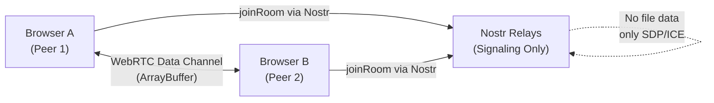
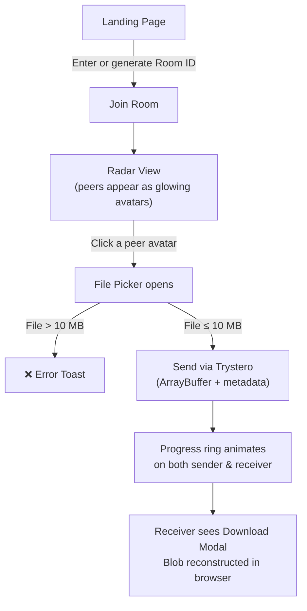

# FastDrop — P2P File Sharing App

> Zero-login, serverless P2P file sharing via WebRTC + Nostr signaling.  
> Built with **Next.js 16 (App Router)** · **Tailwind CSS v4** · **Trystero/Nostr** · **Lucide Icons**

---

## Quick Start

```bash
# 1. Install all dependencies
npm install trystero lucide-react clsx tailwind-merge

# 2. Run in development
npm run dev

# 3. Production build (static export)
npm run build
```

---

## Project Structure

```
file-share/
├── app/
│   ├── globals.css         ← Tailwind + custom animations
│   ├── layout.tsx          ← Root layout with metadata
│   └── page.tsx            ← Full UI (Landing + Room + Radar)
├── hooks/
│   └── useP2PRoom.ts       ← Trystero room lifecycle hook
├── next.config.ts          ← Static export + Turbopack config
└── .vercelignore
```

---

## Architecture



> [!NOTE]
> Files travel **100% peer-to-peer** via WebRTC data channels. Nostr relays are only used for signaling (SDP/ICE negotiation). No file bytes touch any server.

---

## Core Files

### [`hooks/useP2PRoom.ts`](file:///c:/ak%20DevOps/@%20GitHub%20repos%20ak/file-share/hooks/useP2PRoom.ts)

| Export | Purpose |
|--------|---------|
| `useP2PRoom(roomId)` | Main hook — manages room join, peer tracking, file transfers |
| `generateNickname()` | Returns a fun random name like *"Cosmic MacBook"* |
| `generateRoomCode()` | Returns a random 4-digit string |
| `detectDeviceType()` | Returns `'Mobile'` or `'Desktop'` via UA sniffing |

**Key Trystero API usage:**
```ts
const room = joinRoom({ appId: 'p2p-fast-drop-v1' }, roomId);

// Metadata exchange
const metaAction = room.makeAction<PeerMetaPayload>('peer-meta');
metaAction.onMessage = (data, ctx) => { /* update peer list */ };

// File transfer  
const fileAction = room.makeAction<ArrayBuffer>('file-tx');
fileAction.onMessage = (data, ctx) => { /* reconstruct Blob, trigger download */ };
fileAction.onReceiveProgress = (progress, ctx) => { /* update progress bar */ };

// Targeted send
await fileAction.send(buffer, { target: peerId, metadata: fileMeta });

// Peer presence
room.onPeerJoin = (peerId) => { metaAction.send(myMeta, { target: peerId }); };
room.onPeerLeave = (peerId) => { /* remove from state */ };
```

### [`app/page.tsx`](file:///c:/ak%20DevOps/@%20GitHub%20repos%20ak/file-share/app/page.tsx)

| Component | Purpose |
|-----------|---------|
| `HomePage` | Root — switches between Landing and Room views |
| `LandingView` | Room ID input, random code generator, Join button |
| `RoomView` | Full radar UI, peer cards, file input, transfers list |
| `PeerCard` | Clickable avatar with animated glow and progress ring overlay |
| `RadarBackground` | Concentric rings + animated radar pulse rings |
| `ProgressRing` | SVG circular progress indicator (sender & receiver) |
| `DownloadModal` | Confirmation modal for received files with download trigger |
| `Toast` | Auto-dismissing inline alert for errors & status updates |

---

## User Flow



---

## Deploy to Vercel

```bash
# Option A: Vercel CLI
npx vercel --prod

# Option B: Push to GitHub → Import in Vercel Dashboard
# Framework Preset: Next.js
# Build Command: npm run build   (auto-detected)
# Output Directory: out          (static export)
# Environment Variables: NONE required
```

> [!IMPORTANT]
> `next.config.ts` sets `output: 'export'` for fully static generation.  
> No backend, no edge functions, no environment variables needed.

---

## Constraints & Notes

| Feature | Detail |
|---------|--------|
| Max file size | **10 MB** enforced client-side before send |
| Signaling | Nostr public relays (no key required) |
| App ID | `p2p-fast-drop-v1` (change to namespace your room codes) |
| SSR safety | All Trystero calls are inside `'use client'` + `dynamic import()` |
| Peer ID | Assigned by Trystero/WebRTC — not exposed as `selfId` on Room |

---

## Tested Build Output

```
Route (app)
┌ ○ /
└ ○ /_not-found

○  (Static) prerendered as static content
```

✅ TypeScript clean · ✅ Zero warnings in source · ✅ Static export ready
